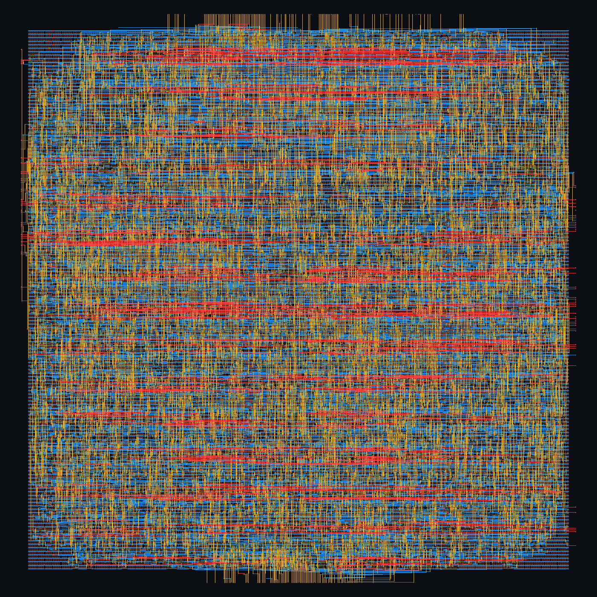
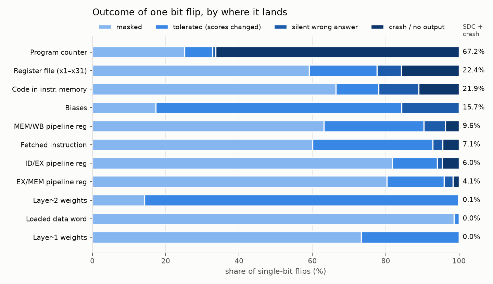
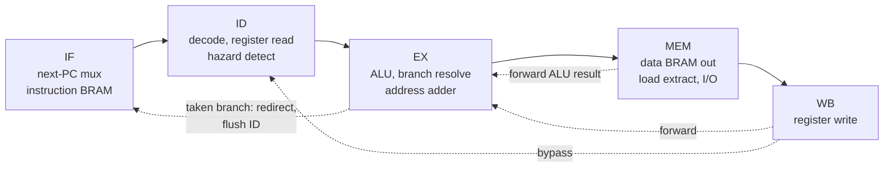

# RV32I RISC-V CPU on a Tang Nano 9K FPGA

A RISC-V CPU written from scratch in Verilog: first a single-cycle core, then a
5-stage pipelined core. Both run C programs compiled with clang on a
Tang Nano 9K (Gowin GW1NR-9) and print over UART. The pipelined core is also
taken through a full ASIC flow to a signed-off layout on SkyWater 130 nm.
Everything is built with open-source tools (yosys, nextpnr, Icarus Verilog,
LibreLane/OpenROAD).

```
Hello from my RISC-V CPU on the Tang Nano 9K!
clock 40500000 Hz
fib(20)   ok  cycles 288797  instr 258547  CPI 1.117  time 7130 us
sort(200) ok  cycles 87869  instr 76892  CPI 1.142  time 2169 us
crc32(1K) ok  cycles 42017  instr 40998  CPI 1.024  time 1037 us
muldiv    ok  cycles 194254  instr 180327  CPI 1.077  time 4796 us
```
*Real output from the board, captured over its USB serial port.*

## Highlights

- **Full RV32I** base integer instruction set. Passes all 40 applicable tests in
  the official [riscv-tests](https://github.com/riscv-software-src/riscv-tests)
  `rv32ui` suite, on both cores.
- **5-stage pipeline** with forwarding, a load-use stall, and branch flushing.
  It runs **1.40–1.57× faster** than the single-cycle core on hardware benchmarks.
- **Runs real C**: clang/LLVM toolchain, startup code, linker script, and a small
  runtime with software multiply/divide (RV32I has no `mul`).
- **Measured on hardware**: cycle and instructions-retired counters are readable
  from software. Cycle counts on the board match simulation exactly.
- **ASIC layout on SkyWater 130 nm**: the core signs off at **90.9 MHz**
  (typical corner) in 0.19 mm², with clean DRC and LVS. See [asic/](asic/).
- **Fault-injection study**: 33 000 single-bit flips into the running CPU
  while it classifies digits with an int8 neural network. Which parts of the
  CPU and model turn a flip into a silent wrong answer. See [fault/](fault/).

## Results

| | Single-cycle | 5-stage pipeline |
|---|---|---|
| Clock on board | 27 MHz | 40.5 MHz (PLL) |
| Fmax (nextpnr, 6 seeds) | 26.3 – 27.1 MHz | 44.3 – 45.4 MHz |
| Logic (LUT4) | 3040 (35%) | 2859 (33%) |
| Flip-flops | 362 | 613 |
| fib(20) | 11 197 µs | 7 130 µs (1.57×) |
| insertion sort, 200 ints | 3 261 µs | 2 169 µs (1.50×) |
| CRC-32, 1 KB | 1 556 µs | 1 037 µs (1.50×) |

Full breakdown, including CPI per benchmark and how the pipeline's clock went
from 27.6 MHz to 44 MHz: **[RESULTS.md](RESULTS.md)**.

## ASIC: SkyWater 130 nm



The pipeline core (`rtl/cpu_core.v`, with memory as external ports) taken
from RTL to GDS with LibreLane:

| | |
|---|---|
| Die | 432 × 443 µm (0.19 mm²) |
| Cells | 11 685 (1 332 flip-flops) |
| Clock, typical corner | **90.9 MHz** |
| Clock, slow corner | ~61 MHz |
| Power at 90.9 MHz | 12.7 mW |
| DRC / LVS | 0 errors / clean |

Clock sweep, caveats and how to reproduce: **[asic/README.md](asic/README.md)**.
<br clear="right">

## Fault injection: bit flips vs. a neural network

The CPU runs an integer-only digit classifier (64 → 32 → 10, int8 weights,
97.6% accuracy, bit-exact with Python). A Verilator harness flips one bit at a
time in any flip-flop or memory word and records what happens.



- **Control state crashes, data state lies:** PC flips crash 66% of the time
  but almost never give a wrong answer; silent wrong answers come from
  biases (15.7%), code (10.9%) and data registers (6.6%).
- **Weights are robust:** no single weight flip costs more than 4.4 accuracy
  points, and only the top two bits of each int8 weight matter.
- **Biases are the weak spot:** one sign flip drops accuracy to chance, and
  81% of harmful bias flips hit bits that int32 storage wastes. Storing them
  as int16 would remove those.

Method, all results, validation and limits: **[fault/README.md](fault/README.md)**.

## Pipeline



- **Data hazards:** forwarding from MEM and WB into EX. The forwarding selects
  are computed in ID and registered, so the register-number comparators stay
  off the critical path. A load directly followed by a user of its result
  stalls 1 cycle.
- **Control hazards:** branches are predicted not-taken and resolved in EX. A
  taken branch or jump costs 1 cycle.
- **Memories:** synchronous block RAM. The instruction RAM is addressed with the
  *next* PC, so its output register is the IF/ID register. The data RAM is
  addressed in EX and its output is read in MEM.

The single-cycle core (`rtl/cpu.v`) uses the same parts and the same
memory-mapped I/O. It spends 2 cycles on data-memory loads because block RAM
reads are clocked.

## Memory map

| Address | Contents |
|---|---|
| `0x0000_0000` – `0x0000_1FFF` | 8 KB program image (code in instruction RAM, a copy in data RAM for `.rodata`/`.data`), stack at the top |
| `0x1000_0000` | UART transmit (write a byte) |
| `0x1000_0004` | exit code (simulation only) |
| `0x1000_0008` | cycle counter |
| `0x1000_000C` | LEDs |
| `0x1000_0010` | UART busy |
| `0x1000_0014` | buttons |
| `0x1000_0018` | instructions retired |
| `0x1000_001C` | clock frequency (Hz) |

## Repository layout

```
rtl/          CPU and system Verilog
  cpu_core.v    5-stage pipelined core (memory as external ports)
  cpu_pipe.v    cpu_core + FPGA block-RAM memories
  cpu.v         single-cycle core
  alu.v regfile.v imm_gen.v imem.v dmem.v bram_be.v
  uart_tx.v     115200 baud transmitter
  top.v         board top level: PLL, reset, I/O devices
tb/           testbenches (unit, C-program, full-system with UART decoder)
sw/           C toolchain setup and programs (crt0, linker script, runtime, board.c)
tests/        riscv-tests runner and bare-metal test environment
constraints/  pin assignments for the Tang Nano 9K
asic/         LibreLane config, run script, results and layout for sky130
ml/           digit classifier: training and integer quantization (Python)
fault/        fault-injection harness (Verilator), campaigns, analysis, figures
learning/     earlier exercises: LED blink, logic gates, counter, ripple-carry adder
```

## Building and running

**Tools:** [OSS CAD Suite](https://github.com/YosysHQ/oss-cad-suite-build)
(yosys, nextpnr-himbaechel, gowin_pack, openFPGALoader, Icarus Verilog) and
LLVM with lld for RISC-V (`brew install llvm lld` on macOS). On macOS, keep
the toolchain out of iCloud-synced folders such as `~/Documents`: offloaded
files make every tool start slow and Docker cannot read them.

```bash
git clone --recursive https://github.com/MilesEhrlich/rv32i-pipelined-cpu.git
source <oss-cad-suite>/environment
```

```bash
./run_tests.sh                    # every simulation suite, both cores
./run_c.sh hello                  # compile sw/hello.c and simulate it
./tests/run_isa_tests.sh          # official riscv-tests on the pipeline
./build_soc.sh                    # synthesize sw/board.c + CPU, load the board
CORE=single ./build_soc.sh        # same, with the single-cycle core
```

Read the board's output with any serial terminal at 115200 baud (on macOS the
board shows up as `/dev/cu.usbserial-*`; use the second of its two ports).

## Verification

- **ISA compliance:** riscv-tests `rv32ui` (40 tests) on both cores. Two are
  excluded: `fence_i` needs self-modifying code, which a Harvard memory layout
  can't run, and `ma_data` tests misaligned access, which the spec makes
  optional.
- **Mutation checks on the pipeline:** disabling any single forwarding path, the
  load-use stall, the WB→ID bypass or branch flushing makes the suite fail.
  This confirms the tests actually exercise the hazard logic.
- **Full-system simulation:** `tb/top_tb.v` runs the whole board design and
  decodes the UART pin bit by bit before anything goes onto hardware.

## Lessons from hardware

Bugs that passed simulation but failed on the FPGA:

1. **A simulation-only zero-fill loop erased the RAM preload.** Yosys let a
   `for` loop that zeroed the memory override `$readmemh`, so the data RAM came
   up empty and every string read back as zeros. Found by inspecting the
   block RAM init values in the synthesized netlist.
2. **A timing "PASS" that wasn't one.** Clocking data memory on the falling edge
   (to keep loads single-cycle) left half a clock period for ~30 ns paths. The
   timing report checked those paths against a full period and reported a
   pass. On the board, loads returned wrong data that depended on the address.
   Fixed by keeping the whole design on one clock edge.
3. **A test script that couldn't fail.** After a Verilog compile error, the ISA
   runner re-ran a stale simulator binary and reported 40/40. It now counts
   compile errors as failures.

## Next steps

- Hardware fault injection on the FPGA, to confirm the simulated results
- Protect the vulnerable state found above (int16 biases, parity on the PC
  and return address) and measure the improvement
- Close timing at the slow ASIC corner; add SRAM macros for a full chip
- Branch prediction (resolve `jal` in ID, a small BTB) to cut the taken-branch penalty
- Instruction and data caches, with memory in the board's PSRAM
