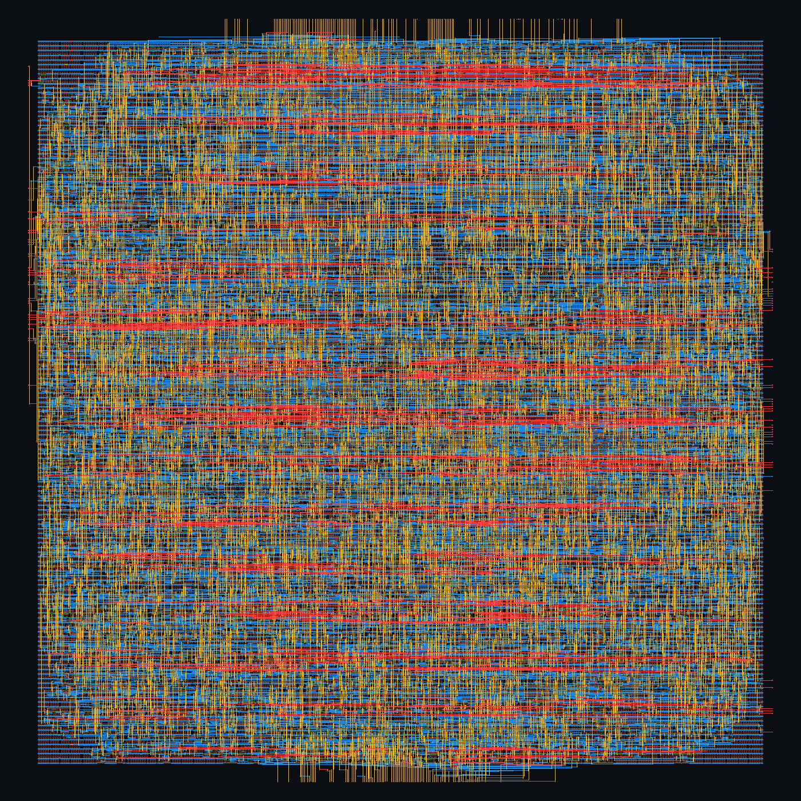

# ASIC flow: the pipelined core on SkyWater 130 nm

The 5-stage core (`rtl/cpu_core.v`) taken from Verilog to a signed-off
layout with [LibreLane](https://github.com/librelane/librelane) (the
maintained successor of OpenLane 2) on the open SkyWater 130 nm PDK
(`sky130A`, high-density cells `sky130_fd_sc_hd`).



*Final layout, 432 × 443 µm. Metal 1 (blue), metal 2 (amber) and metal 3
(red) routing over the standard cells; the I/O pins are along the top and
bottom edges. The power grid is hidden. Rendered with `render_layout.py`.*

## Result (11 ns target, 90.9 MHz)

| | |
|---|---|
| Die | 432 × 443 µm (0.19 mm²) |
| Standard-cell area | 0.11 mm², 64% utilization |
| Cells | 11 685, including 1 332 flip-flops |
| Clock, typical corner (25 °C, 1.8 V) | **90.9 MHz**, +0.68 ns slack |
| Clock, slow corner (100 °C, 1.6 V) | ~61 MHz (−5.3 ns slack at 11 ns) |
| Power at 90.9 MHz (typical) | 12.7 mW |
| DRC (Magic and KLayout) | 0 errors |
| LVS (layout vs. schematic) | clean |
| Antenna, hold, XOR checks | clean |

For comparison, the same core runs at 40.5 MHz on the Tang Nano 9K FPGA
(Fmax ~45 MHz there).

### Clock sweep

| Target | Typical slack | Slow-corner Fmax | Power | Sign-off |
|---|---|---|---|---|
| 25 ns (40 MHz) | +7.0 ns | ~34 MHz | 5.5 mW | pass |
| 20 ns (50 MHz) | +5.0 ns | ~44 MHz | 6.9 mW | pass |
| 15 ns (66.7 MHz) | +3.8 ns | ~58 MHz | 9.2 mW | pass |
| 12 ns (83.3 MHz) | +1.5 ns | ~61 MHz | 11.6 mW | pass |
| **11 ns (90.9 MHz)** | **+0.68 ns** | **~61 MHz** | **12.7 mW** | **pass** |

Slow-corner Fmax = 1 / (period − slow-corner slack). Metrics for every run
are in `results/<tag>/metrics.json`. `results/p20` is the first run, without
the post-route repair steps.

## What the numbers mean (and don't)

- **Core only.** Instruction and data memory are outside this block, as
  ports. A real chip would add SRAM macros (or a small flip-flop memory) and
  pads; the core's critical path already ends at the instruction-memory
  address port, with 20% of the period reserved for the memory outside
  (`IO_DELAY_CONSTRAINT`).
- **Sign-off corner.** LibreLane's default sign-off checks setup timing at
  the typical corner and hold timing at all corners, which is what "pass"
  means above. The slow corner is reported, not enforced. Getting it to close
  would mean optimizing for it directly (`RSZ_CORNERS`, `TIMING_VIOLATION_CORNERS`)
  and probably shortening the branch-redirect path.
- **Slew warnings.** About 320 max-slew warnings remain at the typical corner
  (1 500 at the slow corner), on high-fanout nets from the input ports and
  forwarding selects. They are not part of the default sign-off but would
  need cleaning up for a tapeout.
- **Power** uses the tool's default switching-activity estimate, not
  activity from a real workload.

## What I learned getting here

- **A looser clock made the slow corner worse.** The timing-repair step only
  works on violating paths at the typical corner. At 25 ns there were none,
  so nothing was resized and the slow corner reflected raw logic, including
  slow delay buffers used as fanout buffers. Tighter targets forced real
  optimization and improved every corner.
- **Post-route repair is off by default.** Enabling
  `RUN_POST_GRT_DESIGN_REPAIR` and `RUN_POST_GRT_RESIZER_TIMING` (repairs
  using real wire lengths after global routing) improved slow-corner slack
  at 20 ns from −3.7 to −2.8 ns.
- **iCloud vs. containers.** The repo lives in an iCloud-synced folder, and
  macOS offloads files under disk pressure. Docker's file sharing can't fetch
  them back, so the tools saw empty files ("module not found"). The run script
  stages everything outside iCloud first.

## Reproducing

Needs Docker (on macOS, [Colima](https://github.com/abiosoft/colima) works)
and LibreLane in a virtualenv outside any iCloud-synced folder:

```bash
python3 -m venv ~/.venvs/rv32i-asic && ~/.venvs/rv32i-asic/bin/pip install librelane==3.0.17
colima start --cpu 6 --memory 8 --vm-type vz
```

```bash
asic/run_asic.sh          # 11 ns target from config.json (~10 minutes)
asic/run_asic.sh 15       # another target, tag "p15"
```

The first run downloads the LibreLane image (~7.5 GB) and the sky130 PDK
(~2 GB). Each run directory is about 1 GB, in `~/.cache/rv32i-asic/<tag>`.

Render a layout image from a run's GDS:

```bash
docker run --rm -v $HOME:$HOME -w $PWD ghcr.io/librelane/librelane:3.0.17 \
  bash -c "QT_QPA_PLATFORM=offscreen klayout -b -r asic/render_layout.py \
  -rd gds=<run>/final/gds/cpu_core.gds -rd png=asic/layout.png"
```
