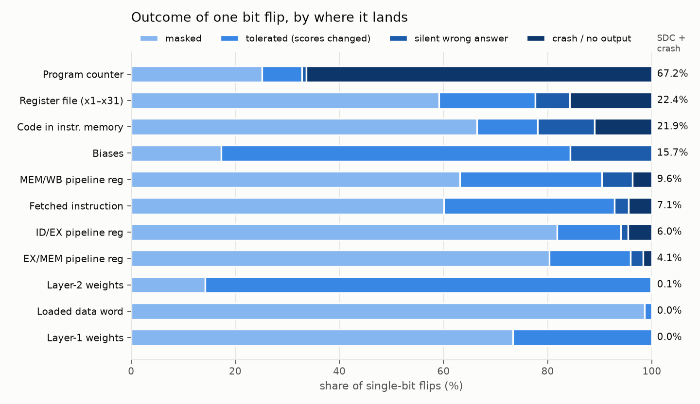
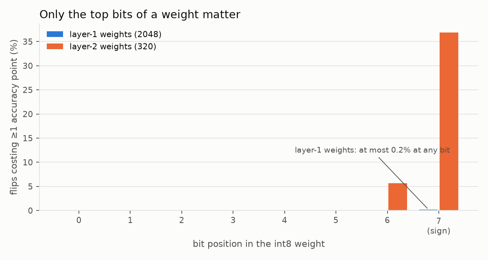

# Bit flips in a CPU running a neural network

**Question:** when one bit flips inside the CPU while it runs a neural network,
how often does the answer change, and does it matter *where* the flip lands?

This is the hardware side of two real problems: **soft errors** (radiation or
voltage noise flipping a bit at random) and **bit-flip attacks** on ML models
(Rowhammer-style attacks that flip chosen bits in stored weights). Because the
CPU here is my own design, every flip-flop can be targeted and the effect
traced to the instruction and register involved.

## Setup

- **Model** ([`ml/train.py`](../ml/train.py)): 8×8 handwritten digits
  (scikit-learn's dataset), 64 → 32 (ReLU) → 10, trained in floating point and
  converted to integer-only inference: int8 weights, int32 biases and
  accumulators, a right-shift to requantize. Accuracy 97.6% (float: 97.8%) on
  540 test images.
- **Inference on the CPU** ([`sw/digits.c`](../sw/digits.c)): RV32I C with
  shift-and-add multiplies (no multiply instruction), ~65 000 cycles per
  image. Bit-exact with the Python model on all 100 stored test images, on
  both cores.
- **Fault injector** ([`fi_sim.cpp`](fi_sim.cpp)): the pipelined core
  (`rtl/cpu_core.v`) compiled with Verilator, plus memories and I/O in C++.
  Each trial resets the CPU, picks a random test image, picks a random bit in
  the target structure, flips it once, runs to completion, and classifies the
  result:

| Outcome | Meaning |
|---|---|
| masked | identical output scores |
| tolerated | scores changed, same answer |
| **silent wrong answer (SDC)** | wrong digit, program finishes normally |
| crash / no output | hang, wild jump outside the code, or no result reported |

CPU state (registers, PC, pipeline registers, the fetched instruction and
loaded data words) is flipped at a uniformly random cycle during the run.
Memory (code, weights, biases) is flipped before the run starts, matching the
weight-attack threat model.

**3 000 trials per structure, 33 000 in total**, plus an exhaustive sweep over
every weight and bias bit (20 288 bits, each measured on all 540 test images).

## Results



Full table with 95% confidence intervals: [results/summary.md](results/summary.md).

### 1. Control state crashes; data state lies

Flips in the **program counter** crash or hang the program 66% of the time
and almost never produce a wrong answer (0.9%). Flips in **data** (biases,
the register file, code) are the ones that produce *silent* wrong answers:
biases 15.7%, code 10.9%, registers 6.6%. Crashes are detectable; silent
errors are the dangerous kind, and they come from different places.

### 2. Most of the register file doesn't matter


Vulnerability is set by how the compiler uses each register. `s4`–`s11`
are never used by this program, so flipping them is always harmless. `ra`
(return address), `s3` (holds the I/O base address used to report the result)
and the loop counters and bounds (`a2`, `t0` count, `a7` holds the bound 32)
almost always crash or lose the output: a flipped counter sends a loop
thousands of iterations off course.
The accumulator and operand registers (`a0`, `a1`, `a4`, `a6`) are where
silent wrong answers come from. A register's vulnerability is a property of
the software, not the hardware.

### 3. Weights are robust; only the top bits matter



Across all 18 944 weight bits, a single flip never costs more than 4.4
accuracy points. Layer-1 weights are almost immune: the worst flip costs 1.1
points, because each weight is one of 64 inputs summed into a hidden unit.
In layer 2, only bit 6 and the sign bit matter: 37% of sign-bit flips cost at
least a point. Bits 0–5 never do.

### 4. Biases are the weak spot, and it's the storage format's fault

Biases make up only 1 344 bits, but they cause the most silent wrong answers
per flip (15.7%). One sign-bit flip in an output bias drops accuracy from
97.6% to **9.4%**, which is chance level. The cause is the format: biases are
stored as int32, but the largest one is 932, which fits in 11 bits. **81% of
the harmful bias flips land in bits 16–31**, bits that only ever hold copies
of the sign. Storing biases as int16 (with the same values) would remove those
flips entirely and halve the bias memory.

### 5. Timing matters for transient faults

A flip on the **loaded data word** is masked 98.6% of the time. It only
corrupts something on the one cycle a load is consuming it. The **fetched
instruction** is similar but riskier (7% SDC + crash), because every cycle
consumes an instruction.

## Is the injector right?

- **Fault-free runs** match the Python model on all 100 images (class and a
  checksum of all 10 scores).
- **Cross-check:** every one of the 9 000 weight and bias flip trials on the
  simulated CPU was recomputed with the integer Python model, and all 9 000
  outcomes agree exactly.
- **Two harness bugs this caught:** the first bias campaign assumed `b2`
  follows `b1` in memory (it doesn't; `W1` does), so a quarter of the "bias"
  trials hit weights; and flips that stopped the result from being reported
  were first counted as wrong answers rather than lost output. Both were
  fixed and the campaigns re-run.

## Limits

- One small model and one program; vulnerability depends on both.
- RTL simulation, not physical faults. Flip-flops are flipped directly; the
  memories are modeled in C++.
- Single-bit, uniformly random faults. Real soft errors can hit several bits,
  and attacks choose their bits (the exhaustive sweep covers the chosen-bit
  case for weights).
- The core has no exceptions, so "crash" means a hang, a jump outside the
  code, or missing output, not a trap.

## Reproducing

```bash
python3 -m venv ~/.venvs/rv32i-ml && ~/.venvs/rv32i-ml/bin/pip install numpy scikit-learn matplotlib
~/.venvs/rv32i-ml/bin/python ml/train.py           # train, quantize, write sw/ml_model.h
fault/build.sh                                      # Verilator build + sw/digits.c
~/.venvs/rv32i-ml/bin/python fault/campaign.py      # 33 000 trials, ~2 minutes on 6 cores
~/.venvs/rv32i-ml/bin/python fault/analyze.py       # cross-check, sweep, figures, summary
```

Raw trial data: `results/<structure>.csv` (one row per trial: site, bit,
image, cycle, outcome).
