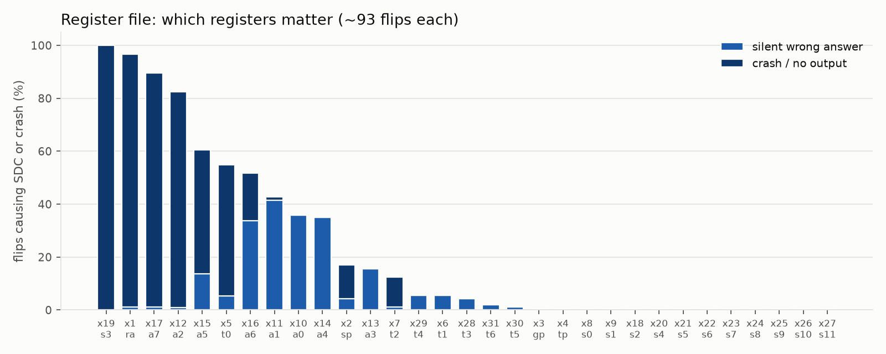
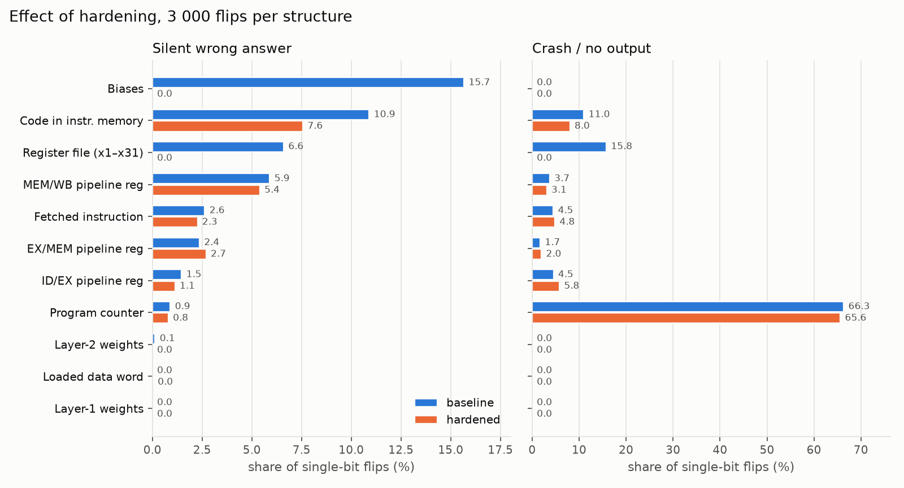

# Bit flips in a CPU running a neural network

**Question:** when one bit flips inside the CPU while it runs a neural network,
how often does the answer change, and does it matter *where* the flip lands?

This is the hardware side of two real problems: **soft errors** (radiation or
voltage noise flipping a bit at random) and **bit-flip attacks** on ML models
(Rowhammer-style attacks that flip chosen bits in stored weights). Because the
CPU here is my own design, every flip-flop can be targeted and the effect
traced to the instruction and register involved.

## Setup

- **Model** ([`ml/train.py`](../ml/train.py)): 8×8 handwritten digits
  (scikit-learn's dataset), 64 → 32 (ReLU) → 10, trained in floating point and
  converted to integer-only inference: int8 weights, int32 biases and
  accumulators, a right-shift to requantize. Accuracy 97.6% (float: 97.8%) on
  540 test images.
- **Inference on the CPU** ([`sw/digits.c`](../sw/digits.c)): RV32I C with
  shift-and-add multiplies (no multiply instruction), ~65 000 cycles per
  image. Bit-exact with the Python model on all 100 stored test images, on
  both cores.
- **Fault injector** ([`fi_sim.cpp`](fi_sim.cpp)): the pipelined core
  (`rtl/cpu_core.v`) compiled with Verilator, plus memories and I/O in C++.
  Each trial resets the CPU, picks a random test image, picks a random bit in
  the target structure, flips it once, runs to completion, and classifies the
  result:

| Outcome | Meaning |
|---|---|
| masked | identical output scores |
| tolerated | scores changed, same answer |
| **silent wrong answer (SDC)** | wrong digit, program finishes normally |
| crash / no output | hang, wild jump outside the code, or no result reported |

CPU state (registers, PC, pipeline registers, the fetched instruction and
loaded data words) is flipped at a uniformly random cycle during the run.
Memory (code, weights, biases) is flipped before the run starts, matching the
weight-attack threat model.

**3 000 trials per structure, 33 000 in total**, plus an exhaustive sweep over
every weight and bias bit (20 288 bits, each measured on all 540 test images).

## Results


Full table with 95% confidence intervals: [results/summary.md](results/summary.md).

### 1. Control state crashes; data state lies

Flips in the **program counter** crash or hang the program 67% of the time
and almost never produce a wrong answer (1.0%). Flips in **data** (biases,
the register file, code) are the ones that produce *silent* wrong answers:
biases 15.7%, code 10.6%, registers 3.7%. Crashes are detectable; silent
errors are the dangerous kind, and they come from different places.

### 2. Most of the register file doesn't matter



Vulnerability is set by how the compiler uses each register. Every saved
register except `s3` goes unused while the network runs, so flipping them is
always harmless. `ra`
(return address), `s3` (holds the I/O base address used to report the result)
and the loop counters and bounds (`a2`, `t0` count, `a7` holds the bound 32)
almost always crash or lose the output: a flipped counter sends a loop
thousands of iterations off course.
The accumulator and operand registers (`a0`, `a1`, `a3`, `a4`, `a6`) are where
silent wrong answers come from. A register's vulnerability is a property of
the software, not the hardware.

### 3. Weights are robust; only the top bits matter


Across all 18 944 weight bits, a single flip never costs more than 4.4
accuracy points. Layer-1 weights are almost immune: the worst flip costs 1.1
points, because each weight is one of 64 inputs summed into a hidden unit.
In layer 2, only bit 6 and the sign bit matter: 37% of sign-bit flips cost at
least a point. Bits 0–5 never do.

### 4. Biases are the weak spot, and it's the storage format's fault

Biases make up only 1 344 bits, but they cause the most silent wrong answers
per flip (15.7%). One sign-bit flip in an output bias drops accuracy from
97.6% to **9.4%**, which is chance level. The cause is the format: biases are
stored as int32, but the largest one is 932, which fits in 11 bits. **81% of
the harmful bias flips land in bits 16–31**, bits that only ever hold copies
of the sign. Storing biases as int16 (with the same values) would remove those
flips entirely and halve the bias memory.

### 5. Timing matters for transient faults

A flip on the **loaded data word** is masked 98.6% of the time. It only
corrupts something on the one cycle a load is consuming it. The **fetched
instruction** is similar but riskier (7% SDC + crash), because every cycle
consumes an instruction.

## Hardening: fixing the weak spots

Three changes aimed at the findings above, each switchable so the baseline
stays reproducible:

| Change | Where | Targets | Cost |
|---|---|---|---|
| **Register parity, fail-stop** | `regfile.v`, `cpu_core.v` (`PARITY=1`) | finding 2 | 32 parity bits, two XOR trees; checked only when an instruction really takes the value from the register file (not from a bypass or forward) |
| **int16 biases** | `digits.c` (`-DBIAS16`) | finding 4 | none (saves 84 bytes) |
| **Model checksum** before inference | `digits.c` (`-DMODEL_CHECK`) | findings 3–4 | 7.4% more cycles per image |

Same 11 structures, 3 000 trials each, same seeds:



- **Silent wrong answers fell from 4.0% to 1.8%** of all 33 000 flips;
  crashes fell from 9.9% to 8.2%.
- **Register file: 3.7% SDC and 16.0% crash became 0% and 0%.** Every
  harmful flip is now caught (46% of flips are detected; the rest are masked).
- **Weights and biases: every flip is detected** (100%, the checksum
  guarantees it for single-bit flips).
- **int16 biases alone**, with no checksum, cut bias SDC from 15.7% to 2.9%
  at zero runtime cost, as the bit-position analysis predicted.
- What is left is unprotected logic: the pipeline registers, the fetched
  instruction, the code in instruction memory and the PC. Covering those
  takes ECC on the memories or duplicated logic, both much more expensive.

Full table: [results_hard/summary.md](results_hard/summary.md).

**A compiler bug in my check, caught by the campaign.** The first hardened
run detected 100% of weight flips but 0% of bias flips. The weights and
biases are compile-time constants, so clang computed the biases' share of
the checksum at compile time (the bias words became `lui`/`addi`
immediates in the code) and the check never read bias memory. The fix is
one empty `asm` statement that hides the pointer from the optimizer. An
integrity check is only as good as the evidence that it reads what it
claims to protect, and fault injection is that evidence.

## On the real board

The simulation results above come from a model of the CPU. To check them on
hardware, [`rtl/fi_top.v`](../rtl/fi_top.v) wraps the same core on the
Tang Nano 9K with a trial controller that needs no PC involvement. Each trial
it restores memory, does a fault-free run, flips one random bit (register file,
parity bit, or PC) at a random cycle of a second run, and sends a 37-byte
report over USB. The injection hooks exist only in this build (`FI_PORTS`);
the core used everywhere else is unchanged.
[`board_fi.py`](board_fi.py) collects the reports and **replays every board
trial in the Verilator simulation** (same image, bit and cycle).

| Build | Target | Board trials | Masked | Tolerated | SDC | Crash | Detected |
|---|---|---|---|---|---|---|---|
| baseline | register file | 5 000 | 68.8% | 11.1% | 4.0% | 16.2% | – |
| baseline | PC | 5 000 | 26.4% | 7.8% | 1.3% | 64.6% | – |
| hardened | register file | 5 000 | 54.4% | 0.0% | **0.0%** | **0.0%** | 45.6% |
| hardened | PC | 5 000 | 25.5% | 7.6% | 0.6% | 64.9% | 1.3% |

- **All 20 000 board trials agree with simulation, one by one:** same
  outcome, same class and score checksum.
- All 20 000 fault-free runs on the board give the Python model's exact class
  and checksum, in the exact cycle count the simulation predicts.
- **Parity works on the FPGA:** 0 silent wrong answers and 0 crashes from
  register flips on the hardened board.
- The board's rates match the simulated campaign within sampling error
  (register file SDC 4.0% on the board vs 3.7% simulated).
- Cost of parity on the FPGA: 6 more LUT-RAM blocks; no measurable change in
  LUTs or maximum clock (42 MHz either way, run at 27 MHz).

**Two simulator bugs the board found.** The first board run agreed with the
simulation on 94% of trials. Running the disagreeing trials through a third
model (Icarus Verilog on the real `fi_top.v`) showed the board was right
both times:

1. *Memory aliasing.* A flipped high bit in a pointer register (e.g.
   `0x21fc` → `0x010021fc`) still reads the right data on hardware, because
   the block RAMs only decode the low 14 address bits. My C++ memory model
   returned 0 past 16 KB, so it counted those flips as harmful. This had
   inflated the simulated register-file SDC rate from 3.7% to 6.6%.
2. *State leaking between trials.* When a simulated trial crashed with a
   store still in the pipeline, the next trial's reset let that store land in
   the freshly loaded memory. The board restores memory long after reset and
   never had the problem.

Both are fixed and every campaign above was rerun. Without the hardware, both
would have stayed hidden: the simulator agreed with itself.

## Is the injector right?

- **Fault-free runs** match the Python model on all 100 images (class and a
  checksum of all 10 scores).
- **Cross-check:** every one of the 9 000 weight and bias flip trials on the
  simulated CPU was recomputed with the integer Python model, and all 9 000
  outcomes agree exactly.
- **Two harness bugs this caught:** the first bias campaign assumed `b2`
  follows `b1` in memory (it doesn't; `W1` does), so a quarter of the "bias"
  trials hit weights; and flips that stopped the result from being reported
  were first counted as wrong answers rather than lost output. Both were
  fixed and the campaigns re-run.

## Limits

- One small model and one program; vulnerability depends on both.
- Injected faults, not physical ones (radiation, voltage glitches). The
  board runs confirm the simulated effects on real hardware for the register
  file and PC; the memories and pipeline registers are simulated only.
- Single-bit, uniformly random faults. Real soft errors can hit several bits,
  and attacks choose their bits (the exhaustive sweep covers the chosen-bit
  case for weights).
- The core has no exceptions, so "crash" means a hang, a jump outside the
  code, or missing output, not a trap.

## Reproducing

```bash
python3 -m venv ~/.venvs/rv32i-ml && ~/.venvs/rv32i-ml/bin/pip install numpy scikit-learn matplotlib
~/.venvs/rv32i-ml/bin/python ml/train.py           # train, quantize, write sw/ml_model.h
fault/build.sh                                      # Verilator build + sw/digits.c
~/.venvs/rv32i-ml/bin/python fault/campaign.py      # 33 000 trials, ~2 minutes on 6 cores
~/.venvs/rv32i-ml/bin/python fault/analyze.py       # cross-check, sweep, figures, summary
# board (Tang Nano 9K plugged in): build, load, collect, replay in simulation
NOLOAD=1 fault/build_board.sh base && ~/.venvs/rv32i-ml/bin/python fault/board_fi.py base --load
NOLOAD=1 fault/build_board.sh hard && ~/.venvs/rv32i-ml/bin/python fault/board_fi.py hard --load
# hardened build
~/.venvs/rv32i-ml/bin/python fault/campaign.py --variant hard
~/.venvs/rv32i-ml/bin/python fault/campaign.py --variant b16 --targets biases
~/.venvs/rv32i-ml/bin/python fault/compare.py       # figure + results_hard/summary.md
```

Raw trial data: `results/<structure>.csv` (one row per trial: site, bit,
image, cycle, outcome).
